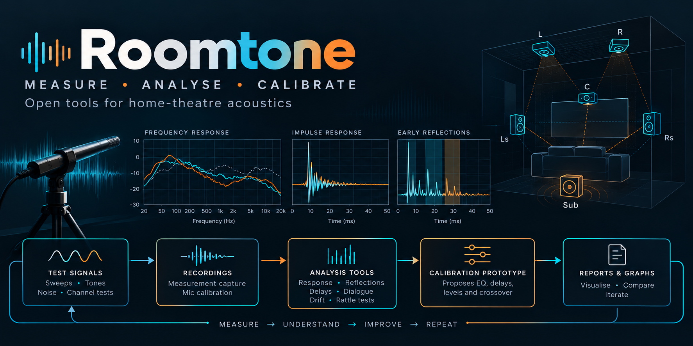
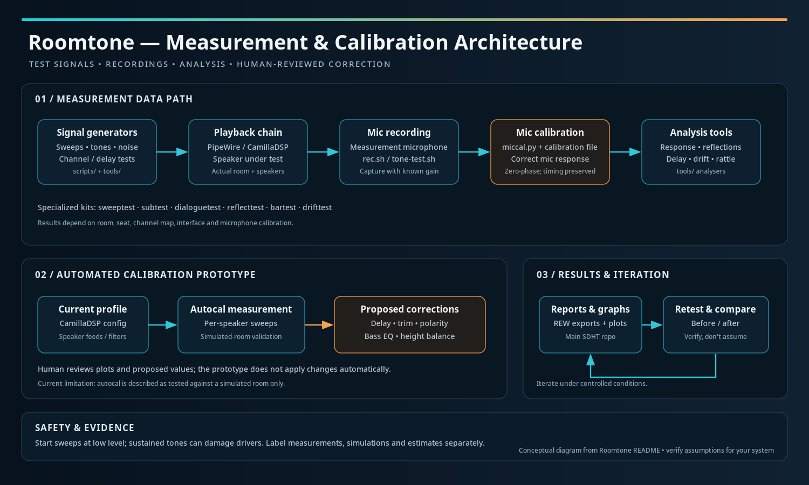

# Roomtone

> **Part of the [Software Defined Home Theatre](https://github.com/praveenchandrahas/Software-Defined-Home-Theatre) project.** The main repository holds the documentation, build log, results and the installer checks; this is one of its parts. Sibling repositories: [linux-theater-dsp](https://github.com/praveenchandrahas/linux-theater-dsp) (router and CamillaDSP configs) · [mpv-object-audio](https://github.com/praveenchandrahas/mpv-object-audio) · [seekthumbs](https://github.com/praveenchandrahas/seekthumbs).
> *Roomtone* (a film term for a location's own ambient sound) is this repository's name since 2026-10-26; it was `theater-measurement`, and GitHub redirects the old address.

Test signals, recording procedures and analysers used to measure and tune a DIY Linux home theatre with a measurement microphone (a Dayton iMM-6S in the original).
Everything here was written for one room and one seat; the kits are general enough to reuse, but read each kit's README for its assumptions.

| Kit | Question it answers |
|---|---|
| `tools/sweeptest/` | speaker-by-speaker sweeps with CamillaDSP in the path: level, arrival time, bass management of the heights |
| `tools/subtest/` | how low the sub goes and where it rattles (tones, sweeps, a rattle detector) |
| `tools/dialoguetest/` | how well speech comes through (a STIPA-style estimate, not a certified STI) |
| `tools/reflecttest/` | are the first-reflection panels working (early-reflection analysis, before and after) |
| `tools/bartest/` | the same tests as a 5.1 set for a soundbar, plus a pan ring, to compare against the rig |
| `tools/analyze-delaytest.py`, `scripts/make-delaytest.py`, `scripts/make-bedtest.py` | the delay-alignment test signals and analyser |
| `scripts/rec.sh`, `scripts/tone-test.sh` | recording (mic gain) and a tone helper |
| `tools/drifttest/` | does a second subwoofer (another clock) stay in phase with the first? Measures the delay between two playback paths over time (ppm drift, jitter, steps) |
| `tools/miccal.py` | removes the measurement microphone's response from every recording the analysers read (see below) |
| `autocal/` | **automated room calibration** ("our own Audyssey"): measures every speaker through the current CamillaDSP profile and proposes delay, trim, polarity, bass-EQ and heights corrections, with a local web page and graphs. Never applies anything by itself. Developed against a simulated room; on the real rig so far it has produced analysed single-position recordings and stopped, by design, at its noise gates; nothing has been applied. See `autocal/README.md` |
| `gui/` | the local **status and control page** (`theater-ctld`, http://127.0.0.1:8765, this computer only): what is playing, profile, engine, CamillaDSP load, and switches for EQ, mode, flavours and engine. Moved here from linux-theater-dsp; it drives the router's `eq` command and never applies room corrections. See `gui/` and the section below |
| `overlay/` | the same status and controls as an **mpv overlay**: press **C** in the player. Moved here from mpv-object-audio |
| `data/` | small REW exports and the microphone calibration file (`data/README.md`); large recordings are not committed |

The figure-drawing scripts that turn these results into the project's graphs are in the [sdht](https://github.com/praveenchandrahas/Software-Defined-Home-Theatre) repository (`tools/make-*.py`), because they also use the router's filter
definitions. The measurement protocol is `docs/measurement.md`; the results, their uncertainty and the build log are in sdht.

## Microphone calibration

All the analysers read recordings through one function that applies the calibration file in `data/mic/` (values subtracted, as REW does; zero-phase, so timing is untouched). The analyser prints
`mic calibration: applied ...` or `NOT applied`. Use `--mic-cal=FILE` or `MIC_CAL=FILE` for another file and `--mic-cal=none` to switch it off. Results published before 2026-10-26 were computed **without** it
(it changes absolute curves by up to about 2 dB and cancels in speaker-to-speaker comparisons).

## Architecture

*Conceptual diagram: it shows how the parts relate, not every file. The room, seat, channel map, interface and microphone calibration are the author's; check each assumption for your system.*
The three blocks map to this repository like this: the **measurement data path** is `tools/` and `scripts/` (signal generators, `rec.sh`, `tools/miccal.py` and the analysers); the **automated calibration prototype** is `autocal/`, which measures through the current CamillaDSP profile and only *proposes* corrections;
**results and iteration** are the graphs and REW exports (graph scripts live in sdht). The status page and the overlay (`gui/`, `overlay/`) sit beside this path: they show and switch the router, they do not measure and they do not apply corrections.

## Status and control (gui/ and overlay/)

- **Page:** `gui/install-ctld.sh` installs `theater-ctld` as a user service on `127.0.0.1:8765` (needs the router's `eq status --json` from linux-theater-dsp first; `remove` undoes it). Shows now-playing, profile and engine, CamillaDSP live numbers (needs its websocket: `-p 1234 -a 127.0.0.1`), and offers EQ, profile mode, flavours and engine as buttons. A live **sound field** shows the level of each of the 8 outputs (FL FR FC LFE SL SR and the two ceiling speakers) in a plan view of the room plus meters, about 20 times a second (`/v1/levels`, read-only `GetPlaybackSignalPeak/Rms`). It is the signal after EQ, not room sound pressure and not object positions; the "loudest" and glow centre are level-weighted, not a rendered object position. Localhost only, a token on every action, fixed action table; details in `gui/theater-ctld`'s header. Tests: `tests/test_ctld.py`.
- **Overlay:** `overlay/install-theater-status.sh --bindings` installs the mpv script and binds **C**. One panel: status first, then a row per setting showing its current value; Enter steps a row, risky changes ask first. Tests: `tests/test_theater_status.py` (mocked mpv, needs `pip install lupa`).
- **Mic noise check:** `python3 -m autocal mic --spectrum` records 15 s (nothing is played) and prints the noise floor per octave band with its spread over time, and the strongest narrow tone, to tell a cycling compressor or fan from electrical hum before a calibration run.

## Adapting it to your system

The calibration file in `data/mic/` belongs to **one** microphone (the author's Dayton iMM-6S); replace it with your own (or run with `--mic-cal=none`). The REW exports in `data/rew/` are from one room, and paths and
channel names in the kits assume the author's 5.1.2 layout and interface. Change them for your setup.

**Safety.** The sweeps and tone tests play loud, sustained low frequencies: start low, keep the sub away from your ears; high-level tones can damage drivers.

Note: the analysers were written with an AI assistant and checked against simulated rooms and REW exports, not independently validated.

## Licence

[Apache License 2.0](LICENSE) (see also [NOTICE](NOTICE)). Dolby, Dolby Atmos, DTS and DTS:X are trademarks of their owners; this project is not affiliated with or endorsed by them. It contains no media files and no decoder code.

Part of the [software-defined home theatre](https://github.com/praveenchandrahas/Software-Defined-Home-Theatre) project.
