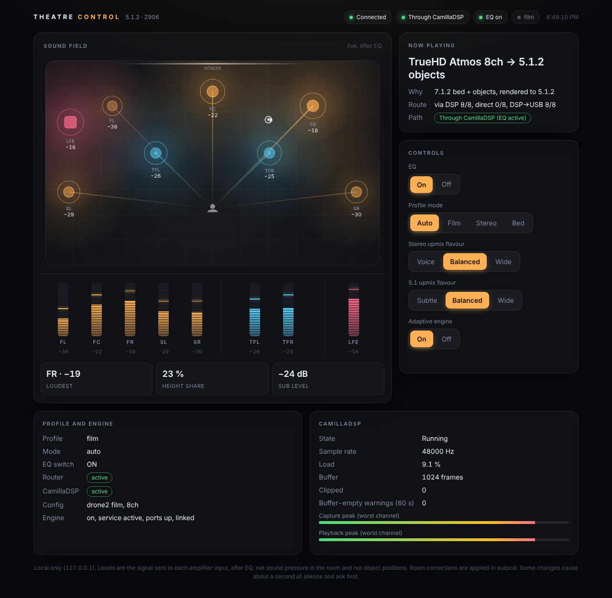
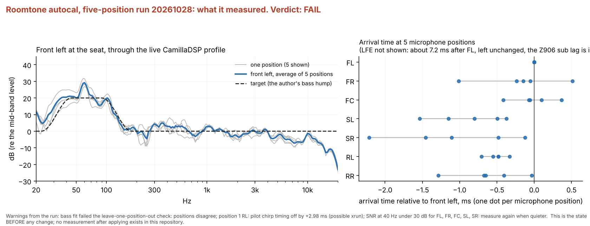
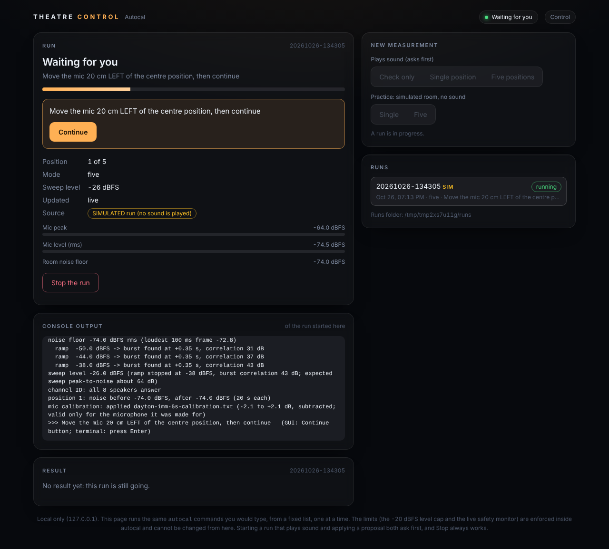
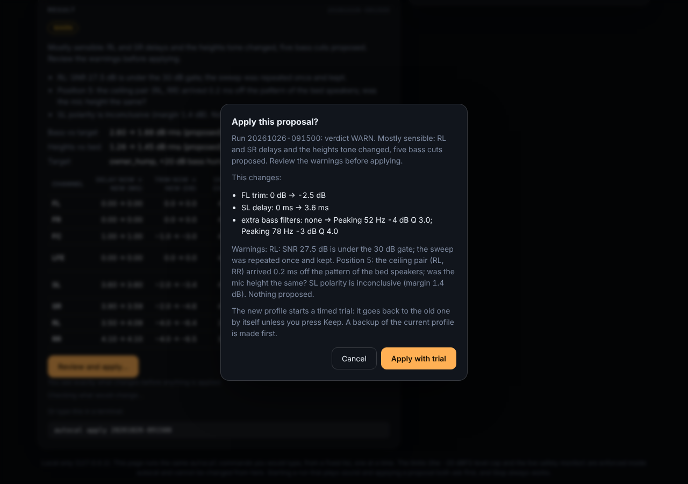

# Roomtone


> **Part of the [Software Defined Home Theatre](https://github.com/praveenchandrahas/Software-Defined-Home-Theatre) project.** The main repository holds the documentation, build log, results and the installer checks; this is one of its parts. Sibling repositories: [linux-theater-dsp](https://github.com/praveenchandrahas/linux-theater-dsp) (router and CamillaDSP configs) · [mpv-object-audio](https://github.com/praveenchandrahas/mpv-object-audio) (player and Atmos wrapper) · [seekthumbs](https://github.com/praveenchandrahas/seekthumbs) (seek-bar thumbnails) · [mpv-shelf](https://github.com/praveenchandrahas/mpv-shelf) (film browser for mpv).
> *Roomtone* (a film term for a location's own ambient sound) is this repository's name since 2026-10-26; it was `theater-measurement`, and GitHub redirects the old address.

**Roomtone is open tooling for measuring a Linux home theatre and calibrating it in a closed loop: it plays sweeps through your live audio chain, records them with a measurement microphone, works out what is wrong with each speaker, proposes corrections, and (only when you say so) applies them to CamillaDSP with a timed trial and a rollback.** The closest commercial analogue is the *workflow* of an Audyssey- or Dirac-style auto-calibrator, on a PC, in the open. It is not a clone of their filters; see [what it is not](#what-roomtone-is-not-yet) before comparing.



## What it does

| Step | What Roomtone does | Where |
|---|---|---|
| Measure | Plays level-ramped sweeps through the **current** CamillaDSP profile, one speaker at a time, at one or five microphone positions. Finds each burst by matched filter, so a noisy room does not hide it. Records the room's noise floor before and after | `autocal/` |
| Check | Preflight, noise floor, level ramp and channel identification (catches dead channels and a wrong microphone input) before any real sweep. Hard output cap of -20 dBFS; aborts on microphone clipping or sub distortion (second harmonic above -20 dBc) | `autocal/safety.py` |
| Analyse | Per-speaker arrival time, level, polarity, bass response and the heights' tone against the bed, with the microphone's calibration file applied | `autocal/`, `tools/` |
| Propose | New delays and trims, polarity flips, a consensus parametric cut below 100 Hz towards a target (the author's deliberate bass hump, `drone2`), and a tone and level match for the height speakers. Boosts only with `--allow-boost`. Changes under 0.15 ms or 1 dB are ignored | `autocal/` |
| Apply, safely | Backs up the live config, installs the change, starts a **timed trial** that reverts by itself unless you press **Keep it**; **Roll back** restores the backup | `autocal apply`, `gui/` |
| Show | A local control page (127.0.0.1 only): a plan view of the room with live per-speaker levels, what is playing, CamillaDSP load, and the autocal page with live progress, "move the microphone" prompts and graphs. The same panel is in mpv (press **C**) | `gui/`, `overlay/` |
| Diagnose | Separate kits for the sub (how low it goes, where it rattles), dialogue (a STIPA-style estimate), early reflections, drift between two playback clocks, and a load and dropout logger for films | `tools/`, `scripts/resource-log` |

## Why this matters on Linux

As far as the author could find (checked in October 2026; tell us if something is missing), the Linux home-theatre ecosystem has good parts and one missing piece:

- **The processing exists.** CamillaDSP and PipeWire can do per-channel delay, EQ, bass management and convolution with very low overhead, and they are well documented.
- **Measurement exists.** REW runs on Linux and is the standard tool for sweeps and analysis.
- **The commercial auto-calibrators do not come to the PC.** Audyssey MultEQ lives in the receiver (its editor is a phone app for supported Denon and Marantz models, [Sound & Vision](https://www.soundandvision.com/content/denon-marantz-launch-audyssey-multeq-editor-app)). Dirac Live's PC-based products are described for Windows and macOS ([StereoNET](https://www.stereonet.com/news/dirac-live-processor-opens-art-to-pc-and-mac-users)); the author found no Linux build, and Dirac's own support page does not list one ([Dirac](https://helpdesk.dirac.com/en/dirac-room-correction/Which-operating-systems-are-supported-by-your-software-d994)). A Linux HTPC that does its own decoding and rendering has no receiver to calibrate it.
- **The gap is the loop in the middle.** On Linux today, the usual route is manual: measure each speaker in REW, choose a target, export filters, hand-write them into CamillaDSP, restart, measure again. Users describe it as slow and easy to get wrong: double-applying the microphone calibration is a known trap, the signal chain is fiddly, and one user called the finished result "a black box you use, then forget for a year or two" ([AV Nirvana thread](https://www.avnirvana.com/threads/linux-guide.13946/post-117850)). DRC-FIR generates good filters but needs a separate convolver and does not apply them ([The Well-Tempered Computer](https://www.thewelltemperedcomputer.com/SW/AudioTools/RoomCorrection.htm)).
- **Immersive layouts are rarely handled.** The usual guides are for stereo or 5.1. Roomtone's measurements and corrections are written for a 5.1.2 layout with height speakers.

Roomtone's contribution is to **close the loop**: measure through the live chain, decide, apply with a safety net, and re-measure, with the microphone calibration and the level and distortion limits built in instead of left to the user.

## How it differs from REW

REW is the better *measurement and analysis* tool, with far more views, a huge user base and years of validation, and Roomtone does not replace it (the REW exports in `data/rew/` were used here). They do different jobs:

| | REW | Roomtone |
|---|---|---|
| Main job | Measure and analyse, interactively | Measure, propose and apply, as a procedure |
| Who drives it | You, step by step | A script (or the web page) runs the whole sequence |
| Plays through your real chain | You set up the routing for each sweep | Plays through CamillaDSP's capture inputs and relinks for you |
| Filters | Auto-EQ and filter export; you carry them to the player | Writes the delay, trim and EQ values CamillaDSP reads, with a backup |
| Safety on the speakers | Your care | Output cap, microphone-clip and sub-distortion stops, timed trial with automatic rollback |
| Multiple microphone positions | Yes, you average them | Prompts you to move the microphone and checks that it did |
| Target | Your choice, flexible | Fixed to the author's bass-hump target for now |
| Validation | Mature | **One room, one seat, one author** |

## A real run: what the five-position measurement showed

<p align="center"></p>

*Real data from the author's room (`data/autocal/20261028-151158/`; redraw with `python3 tools/make-autocal-figure.py`). The raw recordings (95 MB) are not committed.*

- **The verdict was FAIL, and that is the tool working as designed.** The bass fit did not pass the leave-one-position-out check (the five positions disagreed), the 40 Hz signal-to-noise ratio was under 30 dB on FL, FR, FC, SL and SR, and one pilot chirp was off by about 3 ms (a possible xrun). Autocal therefore proposed **no bass EQ and no height-tone change**; it left the bass at 3.3 dB rms from the target before and after.
- **It proposed only small delay changes**, the largest 0.9 ms (SR 2.72 to 3.61 ms; SL 3.00 to 3.66 ms), because the surrounds arrived about 0.9 to 1.1 ms before the front left at the seat.
- **The positions really do differ.** With the microphone moved 20 cm, a speaker's arrival time moves by up to about 2 ms (SR), which is why single-position results should not be trusted below that.
- **It was applied anyway, on purpose.** Autocal refuses to apply a FAIL run unless you force it (`autocal apply --force`, or the page's "Apply anyway" confirmation after a warning); the author forced this one, with the usual timed trial and backup. What changed was therefore only the delays above (no EQ, no height tone). The gates that failed concern the bass fit and the 40 Hz signal-to-noise ratio, which the delays do not depend on; but one pilot chirp (position 1, RL) was suspect, and a 0.9 ms change is of the same order as the scatter between single positions, so the result is plausible, not verified.
- **What is missing:** a measurement after applying a run, and a run that passes its gates. A quieter room (the author's noise floor was the limit) and then `autocal verify` would give the before-and-after this section lacks.

## What Roomtone is not (yet)

- **Not Dirac.** The corrections are delays, trims, polarity and parametric (IIR) cuts. There is no FIR or mixed-phase correction, and the targets are three built-in bass curves (`owner_hump`, `house`, `flat`, below 250 Hz) with no full-range target and no way yet to import your own. Do not expect Dirac's results. **Why not:** CamillaDSP can already run FIR filters, so the engine side is not the obstacle. What is missing is the filter *design* (phase decomposition, regularisation, control of pre-ringing) and, more importantly, the validation: a filter designed from a few microphone positions can sound worse away from them, and this project has not yet verified even its simple corrections (see above). In a small room most of the audible gain is in the bass, which parametric cuts already address; the likely extra gain from FIR is in phase and crossover behaviour, which the author's Z906 handles internally and Roomtone cannot reach. Adding FIR is possible, not planned, and would come after the measure-apply-verify loop is trusted.
- **Validated in one room only.** The author's 10 x 10 ft room, a Dayton iMM-6S microphone and a Z906 plus USB-interface chain. Most pass/fail thresholds are reasoned guesses, and the tests ran against a simulated room first. The only five-position run whose data is in this repository (2026-10-28, below) ended with the verdict **FAIL**; the author forced it through anyway (see below), and this repository holds **no measurement taken after applying anything**, so there is no before-and-after yet.
- **Written with an AI assistant** and checked against simulated rooms and REW exports, not independently validated (see the note at the end).
- **Tied to this project's setup.** It expects CamillaDSP, PipeWire and the router in [linux-theater-dsp](https://github.com/praveenchandrahas/linux-theater-dsp), and the shipped channel map is 5.1.2. Another layout means editing the channel tables.
- **It plays loud, sustained low frequencies.** Read the safety note below before the first real run.

If you try it in your own room, a report of what worked and what broke is the most useful contribution.

## Parts

| Kit | Question it answers |
|---|---|
| `tools/sweeptest/` | speaker-by-speaker sweeps with CamillaDSP in the path: level, arrival time, bass management of the heights |
| `tools/subtest/` | how low the sub goes and where it rattles (tones, sweeps, a rattle detector) |
| `tools/dialoguetest/` | how well speech comes through (a STIPA-style estimate, not a certified STI) |
| `tools/reflecttest/` | are the first-reflection panels working (early-reflection analysis, before and after) |
| `tools/bartest/` | the same tests as a 5.1 set for a soundbar, plus a pan ring, to compare against the rig |
| `tools/analyze-delaytest.py`, `scripts/make-delaytest.py`, `scripts/make-bedtest.py` | the delay-alignment test signals and analyser |
| `scripts/rec.sh`, `scripts/tone-test.sh` | recording (mic gain) and a tone helper |
| `tools/drifttest/` | does a second subwoofer (another clock) stay in phase with the first? Measures the delay between two playback paths over time (ppm drift, jitter, steps) |
| `tools/miccal.py` | removes the measurement microphone's response from every recording the analysers read (see below) |
| `autocal/` | **automated room calibration** (the Audyssey-style workflow, not its filters): measures every speaker through the current CamillaDSP profile and proposes delay, trim, polarity, bass-EQ and heights corrections, with a local web page and graphs. Never applies anything by itself. Developed against a simulated room, then run at the author's rig (five positions, applied, per the author's note of 2026-10-29). See `autocal/README.md` |
| `gui/` | the local **status and control page** (`theater-ctld`, http://127.0.0.1:8765, this computer only): what is playing, profile, engine, CamillaDSP load, and switches for EQ, mode, flavours and engine. Moved here from linux-theater-dsp; it drives the router's `eq` command and never applies room corrections. See `gui/` and the section below |
| `overlay/` | the same status and controls as an **mpv overlay**: press **C** in the player. Moved here from mpv-object-audio |
| `data/` | small REW exports and the microphone calibration file (`data/README.md`); large recordings are not committed |

The figure-drawing scripts that turn these results into the project's graphs are in the [sdht](https://github.com/praveenchandrahas/Software-Defined-Home-Theatre) repository (`tools/make-*.py`), because they also use the router's filter
definitions. The measurement protocol is `docs/measurement.md`; the results, their uncertainty and the build log are in sdht.

## Microphone calibration

All the analysers read recordings through one function that applies the calibration file in `data/mic/` (values subtracted, as REW does; zero-phase, so timing is untouched). The analyser prints
`mic calibration: applied ...` or `NOT applied`. Use `--mic-cal=FILE` or `MIC_CAL=FILE` for another file and `--mic-cal=none` to switch it off. Results published before 2026-10-26 were computed **without** it
(it changes absolute curves by up to about 2 dB and cancels in speaker-to-speaker comparisons).

## Architecture


*Conceptual diagram: it shows how the parts relate, not every file. The room, seat, channel map, interface and microphone calibration are the author's; check each assumption for your system.*
The three blocks map to this repository like this: the **measurement data path** is `tools/` and `scripts/` (signal generators, `rec.sh`, `tools/miccal.py` and the analysers); the **automated calibration prototype** is `autocal/`, which measures through the current CamillaDSP profile and only *proposes* corrections;
**results and iteration** are the graphs and REW exports (graph scripts live in sdht). The status page and the overlay (`gui/`, `overlay/`) sit beside this path: they show and switch the router, they do not measure and they do not apply corrections.

## Status and control (gui/ and overlay/)

- **Page:** `gui/install-ctld.sh` installs `theater-ctld` as a user service on `127.0.0.1:8765` (needs the router's `eq status --json` from linux-theater-dsp first; `remove` undoes it). Shows now-playing, profile and engine, CamillaDSP live numbers (needs its websocket: `-p 1234 -a 127.0.0.1`), and offers EQ, profile mode, flavours and engine as buttons. A live **sound field** shows the level of each of the 8 outputs (FL FR FC LFE SL SR and the two ceiling speakers) in a plan view of the room plus meters, about 20 times a second (`/v1/levels`, read-only `GetPlaybackSignalPeak/Rms`). It is the signal after EQ, not room sound pressure and not object positions; the "loudest" and glow centre are level-weighted, not a rendered object position. Localhost only, a token on every action, fixed action table; details in `gui/theater-ctld`'s header. Tests: `tests/test_ctld.py`.

<p align="center"></p>

*The control page (dark theme; it follows your system theme, so there is a light one too: [`docs/img/control-light.png`](docs/img/control-light.png)). These screenshots were taken against a simulated CamillaDSP that generates moving levels, so the numbers and the "now playing" text are made up for the picture, not a recording of a film on the rig.*

- **Autocal page:** `http://127.0.0.1:8765/autocal` (link in the control page's header). Start a measurement, watch it (step, progress, position, mic meters, room noise floor, the run's console output), answer "move the microphone" with **Continue**, **Stop the run**, read the verdict, warnings and per-channel table of any past run, and **apply** a finished run's proposal. It reads `runs/` from this checkout (`gui/install-ctld.sh` sets `THEATER_AUTOCAL_RUNS` / `THEATER_AUTOCAL_REPO` in the service; re-run it to update).
  - **It runs the same `autocal` commands you would type**, as a subprocess from a fixed table, no shell, no free-form options: `check`, `run --mode single|five`, and two simulated practice runs (`--simulate`, no sound). The only variable parts are a run id that matched `YYYYMMDD-HHMMSS` and the runs folder this service computed.
  - **Guardrails.** One run at a time (also not while a run was started in a terminal, and not while a trial of an applied profile is pending). Starting anything that plays sound asks first and says what will be played. The -20 dBFS level cap and the live safety monitor are inside autocal and the page has no way to change them. **Stop** writes `control/abort` (what the terminal's Ctrl-C ends up doing) and, for a run the page started, sends SIGINT after 3 s and SIGTERM after 8 s if the run is still alive.
  - **Apply** first shows what will change (per-channel delay and trim, extra bass filters, height tone: the run's starting room against `room.proposed.json`), the verdict and warnings, and says it starts a timed trial (a backup is made first); you then press **Keep it** or **Roll back now**, or the trial reverts by itself. A **FAIL** verdict needs a second, explicit "apply anyway (force)" confirmation, the same as `autocal apply --force`; autocal itself refuses without it. **Simulated runs are never applied** to the real system (autocal refuses too).
  - The service unit has `KillMode=process` so that restarting the page does not kill a running measurement or the watchdog that reverts a trial.
  - Same security model as the rest of the page: 127.0.0.1 only, Host/Origin checks, the token on every POST. Tests: `tests/test_ctld.py` (a fake `autocal` records the exact argv).

<p align="center"></p>
<p align="center"></p>

*Screenshots: the first is a real `autocal run --simulate` driven from the page (no sound played); the second uses a generated result from `autocal/web/mock.py`, so its numbers are made up.*
- **Overlay:** `overlay/install-theater-status.sh --bindings` installs the mpv script and binds **C**. One panel: status first, then a row per setting showing its current value; Enter steps a row, risky changes ask first. Tests: `tests/test_theater_status.py` (mocked mpv, needs `pip install lupa`).
- **Mic noise check:** `python3 -m autocal mic --spectrum` records 15 s (nothing is played) and prints the noise floor per octave band with its spread over time, and the strongest narrow tone, to tell a cycling compressor or fan from electrical hum before a calibration run.

## Load and dropouts during a film (`scripts/resource-log`)

Run it in a terminal, start the film, press Ctrl+C at the end (add `--gpu-sudo` on an Intel GPU, which needs root for its GPU counters and asks for your password once):

```bash
scripts/resource-log --label atmos --gpu-sudo
```

It writes `~/resource-log/<time>-atmos/summary.md` (read this first), `samples.csv` (one row per second), `environment.txt`, `pw-top.log` and `camilladsp-journal.txt`. It only reads: `/proc`, `/sys`, CamillaDSP's read-only websocket (port 1234, as the status page uses), mpv's IPC socket, `journalctl --user`, and `pw-top`, `nvidia-smi` or `intel_gpu_top` when present.

The summary starts with the problems: CamillaDSP "buffer empty" log lines while mpv was running (and the same count for the time it was not, because CamillaDSP logs them about every 21 ms when idle), clipped samples, processing load and buffer level; PipeWire xruns; mpv dropped, delayed and mistimed frames and the audio/video sync offset; CPU temperature, clock and thermal-throttle events; CPU, I/O and memory stalls (PSI); the network rate. Then the CPU and RAM of each component (mpv with the Omniphony engine and harletty-bridge inside it, CamillaDSP, PipeWire, WirePlumber, the router, the upmix engine, this page, seekthumbs) and the whole-computer CPU, RAM and GPU. A source that is not available is reported as "not measured", never as zero. Run it once with the film stopped for the idle baseline, and for a fair load number stop other work first (a seekthumbs build reads the same disk, network and CPU).

**First runs on the rig (2026-10-28):** three runs of about a minute each on one small local file (Atmos, idle, DTS:X). It worked end to end. Known rough edges seen: GPU data was empty in one `--gpu-sudo` run and present in another (run `sudo -v` right before; plain `intel_gpu_top` without root aborts on that machine); CamillaDSP buffer level read a constant 0 in every run (including one with PipeWire xruns), so that probe is unconfirmed; mpv A/V sync read 0.0 ms in the two small-file runs but moved (max 32 ms) in a 10-minute 4K run, so that probe works; and the warning count includes about one "WebSocket protocol error" a second from the status page's own connection, which is harmless.

What it does not do: measure end-to-end audio latency (`environment.txt` lists the configured PipeWire and CamillaDSP settings, which are settings, not a measurement), or show per-process GPU use. Tested here against stand-in processes, a fake CamillaDSP websocket and mpv socket, and fake `journalctl`, `pw-top` and `intel_gpu_top` (`tests/test_resource_log.py`), and then run on the rig on 2026-10-28 (see above); the real `intel_gpu_top` and CamillaDSP log wording worked there, with the rough edges listed.

## Adapting it to your system

The calibration file in `data/mic/` belongs to **one** microphone (the author's Dayton iMM-6S); replace it with your own (or run with `--mic-cal=none`). The REW exports in `data/rew/` are from one room, and paths and
channel names in the kits assume the author's 5.1.2 layout and interface. Change them for your setup.

**Safety.** The sweeps and tone tests play loud, sustained low frequencies: start low, keep the sub away from your ears; high-level tones can damage drivers.

Note: the analysers were written with an AI assistant and checked against simulated rooms and REW exports, not independently validated.

## Licence

[Apache License 2.0](LICENSE) (see also [NOTICE](NOTICE)). Dolby, Dolby Atmos, DTS and DTS:X are trademarks of their owners; this project is not affiliated with or endorsed by them. It contains no media files and no decoder code.

Part of the [software-defined home theatre](https://github.com/praveenchandrahas/Software-Defined-Home-Theatre) project.
